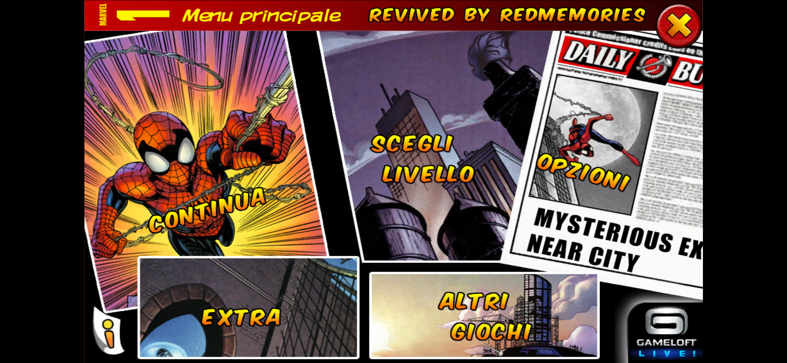
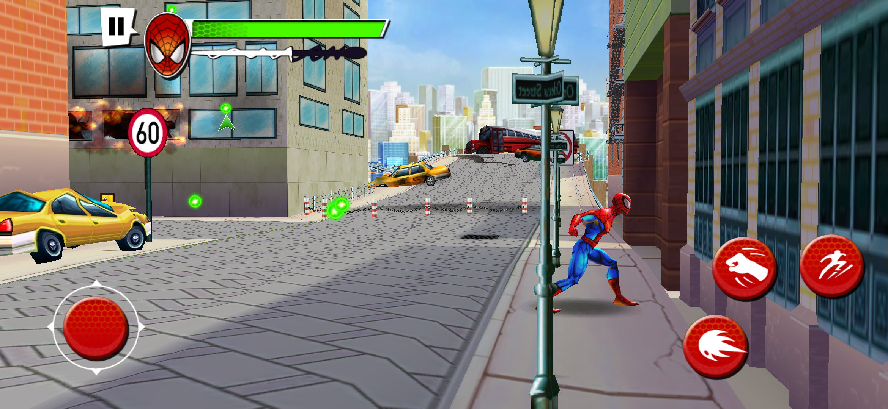
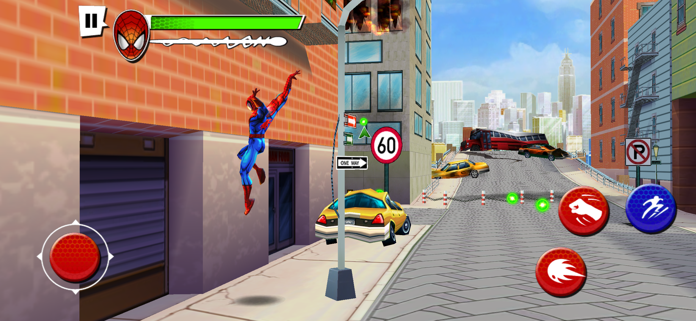

# Spider-Man Total Mayhem Revived

> Spider-Man is a trademark of Marvel. Spider-Man: Total Mayhem is a mobile game by Gameloft. This is a non-commercial fan project, not affiliated with Marvel or Gameloft. The game was pulled from the stores years ago. This repo is my private archive, please don't share the release files.

## What I did

I didn't remake the game and I didn't touch the gameplay. The levels, the villains and the story are exactly the ones from 2010.

Like with The Amazing Spider-Man 2, I converted the whole engine to native 64-bit code ahead of time: 19,089 of its 19,096 functions, recompiled for today's phones. The game simply runs as a modern app.

Once it was running, I gave it the treatment it deserves on a modern phone:

- full screen on today's tall displays, edge to edge: the city fills the whole screen, while menus and HUD keep their original proportions instead of being stretched
- the joystick and the action buttons sit at the real edges of the screen, the same distance from the edge they had on the tablets the game was made for, and touches work across the whole display, so the joystick doesn't let go when your thumb drifts toward the edge
- native resolution, the game is drawn with every pixel of the screen
- 120 fps on 120 Hz screens, with the game speed still right
- the game's compressed textures use a format today's GPUs can't read anymore, so they are now decoded when the game loads them
- music and sound effects follow the media volume: the original game went completely silent when the phone was on vibrate or silent mode

The game data lives in the app's own folder, so it doesn't need access to your storage, it doesn't read your phone's ID anymore and it doesn't ask for any permission. The game data is packed inside the APK, so there's nothing to download separately.

## Install

1. Download the APK from **Releases**
2. Install it
3. Open it. The first launch takes a little while to unpack the game, after that it starts right away

No PC, no extra downloads, no account.

## Requirements

- 64-bit Android phone with Android 10 or newer
- about 1 GB of free space

I play it on a Galaxy S26 Ultra with Android 17. I haven't tried it on phones without a Snapdragon chip yet (MediaTek Dimensity, Exynos, Google Tensor): if you play on one of them, let me know how it runs.

## Credits

Revived by **RedMemories**

Thanks to the [dynarmic](https://github.com/azahar-emu/dynarmic) project: its ARM decoder is the base of the recompiler, and it still runs the few bits of the engine that aren't recompiled.

Original game by Gameloft.
